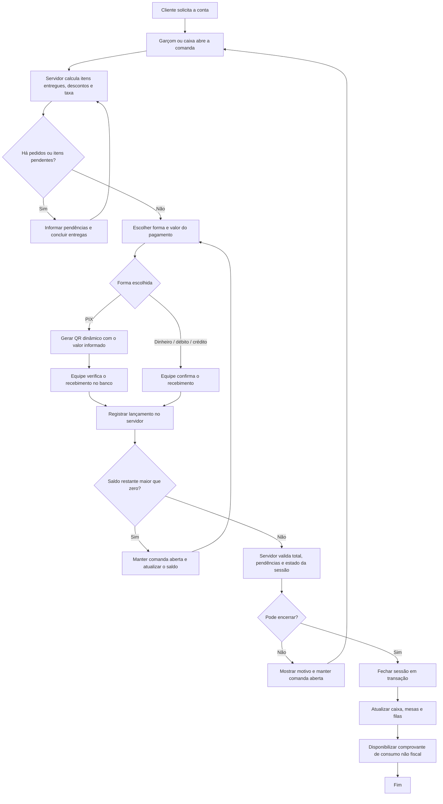

<div align="center">

# QR Admin

**Sistema de pedidos e operação por QR Code para um único estabelecimento**

O QR Admin é apresentado como uma solução genérica de pedidos e operação por QR Code. A personalização visual e comercial de cada estabelecimento será feita posteriormente.

[](https://qradmin.up.railway.app/)

</div>

---

## Objetivo e escopo

O QRAdmin é uma aplicação **single-tenant**: uma instalação representa um único estabelecimento. O foco atual é colocar o produto em operação em uma lanchonete real, com fluxo simples e dados consistentes.

- Não é, neste momento, um SaaS multi-loja.
- Não existe isolamento de dados por estabelecimento em todas as consultas da aplicação; não reutilize esta instalação para outra empresa esperando separação automática.
- Não há gateway bancário integrado nem confirmação automática de recebimento PIX.
- O sistema registra pedidos, preparo, entrega e lançamentos de pagamento; a confirmação do dinheiro/PIX recebido continua sendo responsabilidade da equipe.

## Fluxo operacional

```text
Cliente escaneia o QR da mesa
        ↓
Cardápio → carrinho → pedido
        ↓
Cozinha ou bar prepara os itens
        ↓
Garçom entrega os itens prontos
        ↓
Caixa confere os itens entregues, registra pagamento e fecha a comanda
```

A comanda da mesa é acumulativa: a mesa pode receber vários pedidos durante a visita. O total cobrável é calculado no servidor a partir dos itens entregues, não do total enviado pelo navegador.

## Fluxo de pagamento e encerramento da comanda

O pagamento deve seguir o fluxo abaixo. O PostgreSQL e as validações do servidor são a fonte de verdade; a interface não deve considerar uma comanda fechada só porque o operador clicou no botão.



### Regras operacionais para cobrança

1. **Confira a comanda:** o total é calculado no servidor a partir dos itens entregues, com os descontos e a taxa de serviço aplicáveis. Não confie em totais calculados somente no navegador.
2. **Verifique pendências:** pedidos ou itens que ainda não foram concluídos devem ser resolvidos antes do encerramento. A interface deve explicar o que está impedindo fechar a conta.
3. **PIX não é confirmação de pagamento:** gere o QR com o valor que será cobrado, mas confirme o crédito no aplicativo bancário antes de registrar o recebimento. Esta versão não tem confirmação automática por banco/gateway.
4. **Pagamentos parciais:** registre cada parcela com sua forma e valor; mantenha a comanda aberta enquanto houver saldo. Atualize a lista e o saldo após cada lançamento.
5. **Evite duplicidade:** operações financeiras devem respeitar a idempotência do servidor. Em caso de timeout, consulte o estado atualizado antes de tentar lançar o mesmo pagamento novamente.
6. **Fechamento consistente:** só considere a mesa livre depois que o servidor confirmar o encerramento. Se o pagamento for registrado, mas o fechamento falhar, informe os dois estados explicitamente e não esconda a comanda.
7. **Histórico e comprovante:** preserve os lançamentos e apresente os itens, quantidades, valores unitários, adicionais, descontos, taxas, formas de pagamento e total. O comprovante de consumo não substitui documento fiscal.

### Validação obrigatória antes de publicar

Teste em banco isolado pelo menos estes cenários: pagamento parcial seguido de quitação; PIX e confirmação manual; dinheiro e cartões; toque duplo/repetição de requisição; tentativa de fechar com itens pendentes; sessão já fechada; falha entre o registro do pagamento e a atualização da interface; descontos e taxa de serviço; e atualização da lista de mesas após o encerramento. Não execute testes mutáveis no banco de produção.

## Funcionalidades

### Cliente — QR da mesa
- Abre o cardápio no navegador, sem instalar aplicativo.
- Pesquisa produtos, escolhe adicionais/removíveis disponíveis e monta o carrinho.
- Informa o nome e envia pedidos para a comanda da mesa.
- Acompanha o andamento do pedido.
- O cliente **não registra pagamento nem confirma recebimento PIX** pela tela pública nesta versão.

### Cozinha e bar
- Filas separadas por setor de produção.
- Transições de status dos itens e pedidos.
- Atualização em tempo real via Server-Sent Events (SSE) e alertas sonoros/voz nas telas compatíveis.

### Garçom
- Link individual por token, que pode ser desativado pelo administrador.
- Atribuição de mesas, identificação do responsável e histórico de transferência.
- Entrega total ou parcial dos itens que ficaram prontos.
- PWA em `/garcom-pwa/`, com manifesto instalável e fila local no IndexedDB para pedidos criados sem conexão.
- A sincronização offline depende de reconexão e do aplicativo voltar a executar no navegador. Preços, disponibilidade e estoque são sempre validados pelo servidor; um conflito precisa ser revisado, não presumido como pedido confirmado.
- **A PWA ainda precisa de validação ponta a ponta em navegador/dispositivo real e PostgreSQL isolado antes de ser considerada pronta para a venda.**

### Caixa
- Lista de comandas abertas e itens entregues.
- Registro de pagamentos parciais, fechamento de comanda, desconto e taxa de serviço.
- Formas de pagamento registradas: dinheiro, PIX, débito e crédito.
- Comprovante de consumo **não fiscal**.
- O QR PIX é estático/configurado por chave. A equipe deve verificar o recebimento no aplicativo bancário antes de considerar o valor pago; gerar QR ou receber aviso não prova liquidação bancária.

### Administração
- Categorias, produtos, preços, disponibilidade, setor de produção, estoque e adicionais.
- Configuração de mesas e geração de QR fixo por mesa (até 70 mesas habilitadas pela interface atual).
- Cadastro e ativação/desativação de garçons.
- Indicadores diários, relatórios por período, histórico e ferramenta de limpeza de histórico.
- Upload/otimização de fotos para WebP.

## Telas e endereços

| Área | Endereço | Uso |
|---|---|---|
| Início | `/` | Entrada do sistema |
| Cliente | `/#/mesa/:token` | Cardápio e pedido da mesa |
| Login | `/#/login` | Acesso da equipe |
| Cozinha | `/#/cozinha` | Fila de preparo |
| Bar | `/#/bar` | Fila de bebidas |
| Garçom | `/#/garcom/:token` | Redireciona para a PWA |
| PWA do garçom | `/garcom-pwa/?token=...` | Atendimento móvel e fila offline |
| Caixa | `/#/caixa` | Pagamentos e fechamento |
| Administração | `/#/admin` | Cardápio, mesas, equipe e relatórios |

Os tokens presentes nos links de mesa e garçom funcionam como credenciais de acesso. Não os publique em issues, prints públicos ou logs; desative o garçom se o link for exposto.

## Tecnologias

- **Frontend principal:** React 19, Vite, TypeScript, Tailwind CSS, Zustand e Framer Motion.
- **PWA do garçom:** JavaScript, HTML/CSS, Service Worker e IndexedDB.
- **Servidor/API:** Node.js com HTTP nativo.
- **Banco:** PostgreSQL com migrations SQL versionadas.
- **Tempo real:** Server-Sent Events (SSE).
- **Fotos:** Sharp, conversão e redimensionamento WebP.

O PostgreSQL é a fonte de verdade. `data/db.json` é um catálogo de demonstração usado pelo seed, não um banco operacional em produção.

## Rodar localmente

Requisitos: Node.js 20 ou superior e um PostgreSQL de desenvolvimento/teste.

1. Instale as dependências:

   ```bash
   npm ci
   ```

2. Copie `.env.example` para `.env` e configure `DATABASE_URL` para um **banco local/de teste**.

3. Defina uma senha inicial forte em `STAFF_SEED_PASSWORD` (mínimo de 12 caracteres em produção). Configure também `PIX_CHAVE`, `PIX_NOME`, `PIX_CIDADE` e `APP_TIMEZONE` quando aplicável.

4. Aplique as migrations e, somente se o banco for novo/de teste, carregue o catálogo de demonstração:

   ```bash
   npm run db:migrate
   npm run db:seed
   ```

5. Gere o frontend e inicie o servidor:

   ```bash
   npm run build
   npm start
   ```

6. Abra `http://localhost:3000`.

**Cuidado com o seed:** `FORCE_SEED=1 npm run db:seed` é destrutivo. Ele apaga pedidos, sessões, pagamentos e cardápio antes de substituir os dados de demonstração. Nunca rode esse comando no banco de produção. A identidade visual atual é provisoriamente QR Admin. A personalização da marca de cada estabelecimento deve ser feita em etapa futura, após validação do produto.

## Testes e validação

Comandos disponíveis:

```bash
npm run typecheck
npm run build
npm run test:regression
npm run test:smoke
npm run test:full
npm run test:seguranca
npm run test:carga
npm run test:carga70
npm run test:dia
```

- `test:regression`: regressões automatizadas, incluindo contratos do backend e testes estáticos da PWA.
- `test:smoke` e `test:full`: precisam de servidor, PostgreSQL e usuários/cardápio preparados; criam ou alteram dados.
- `test:seguranca`: testa autorização, IDOR, CSRF, limite de corpo e outras defesas contra um servidor real; cria/edita dados de teste e não deve apontar para produção.
- `test:carga`, `test:carga70` e `test:dia`: cenários operacionais/concor­rentes que alteram dados. Rode-os **somente em ambiente isolado**, nunca no banco usado pela lanchonete.

O CI do GitHub executa instalação limpa, TypeScript, build, testes de regressão e verificações de sintaxe. CI verde não substitui teste de integração contra PostgreSQL, teste visual em navegador real nem validação no Railway.

## Banco e deploy

- As migrations ficam em `db/migrations/` e são aplicadas em ordem pelo runner `npm run db:migrate`.
- O servidor tenta verificar/aplicar migrations ao iniciar, mas esse caminho é **best-effort**: pode iniciar mesmo se a migration falhar. Confira os logs do deploy e confirme que todas as migrations esperadas foram aplicadas antes de operar.
- Não rode migrations, seed ou testes mutáveis sem confirmar qual banco está conectado.
- Antes da primeira operação comercial, valide login/perfis, pedido até entrega, estoque, fechamento e pagamentos em banco isolado; teste também restauração de backup.
- A PWA deve ser validada em Android/navegador real, inclusive reconexão, conflito de sincronização, atualização do Service Worker e links de mesa/garçom.

## Estado honesto do produto

| Área | Situação |
|---|---|
| Fluxo base de QR, comanda, cozinha/bar e caixa | Implementado; requer validação final no ambiente de operação |
| Segurança e concorrência do backend | Há proteções e regressões automatizadas; ainda requer auditoria comportamental e teste com PostgreSQL real |
| PWA de atendimento do garçom | Implementação integrada; requer validação ponta a ponta antes de ser considerada estável |
| Comprovante de consumo não fiscal | Implementado; não substitui documento fiscal |
| PIX | QR/chave estática e lançamento manual; sem gateway ou confirmação bancária automática |
| Multi-loja / multi-tenant | Fora do escopo atual |
| Pronto para venda/produção | **Não declarar pronto até concluir a validação isolada e operacional** |

---

<div align="center">

**QR Admin** · sistema de pedidos por QR Code para um estabelecimento  
[deividjmoura](https://github.com/deividjmoura)

</div>
