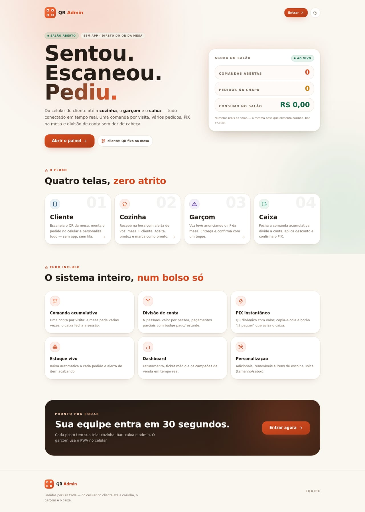
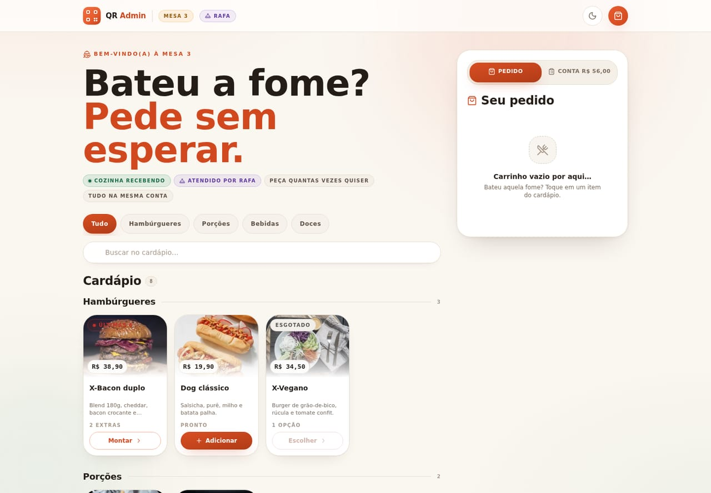
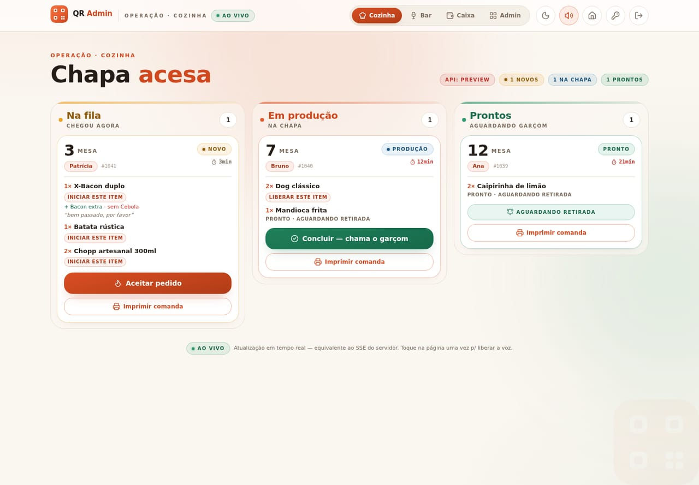
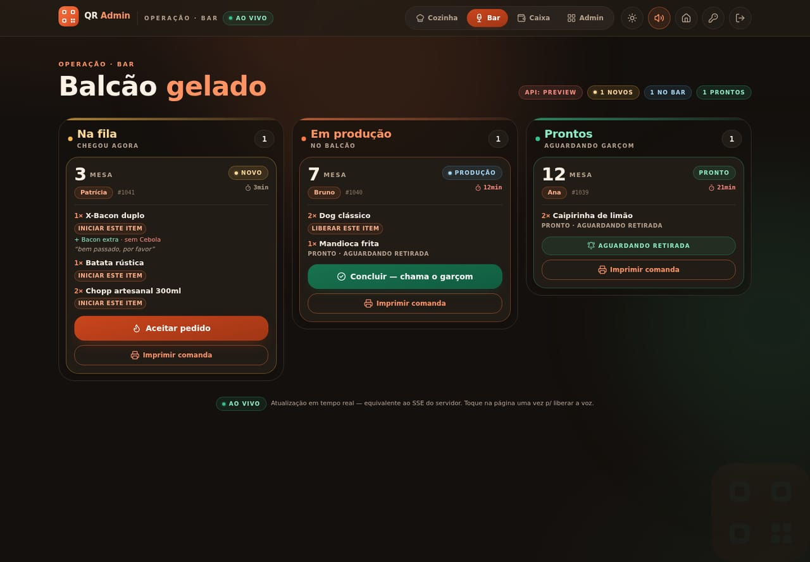
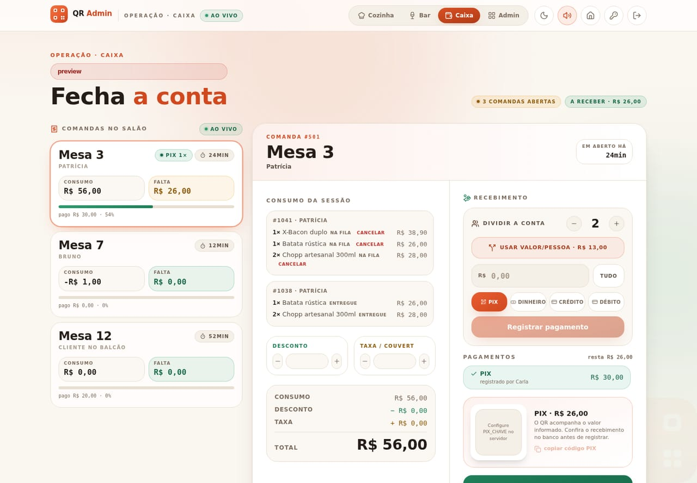
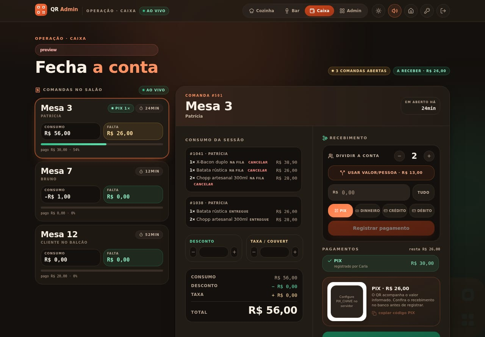
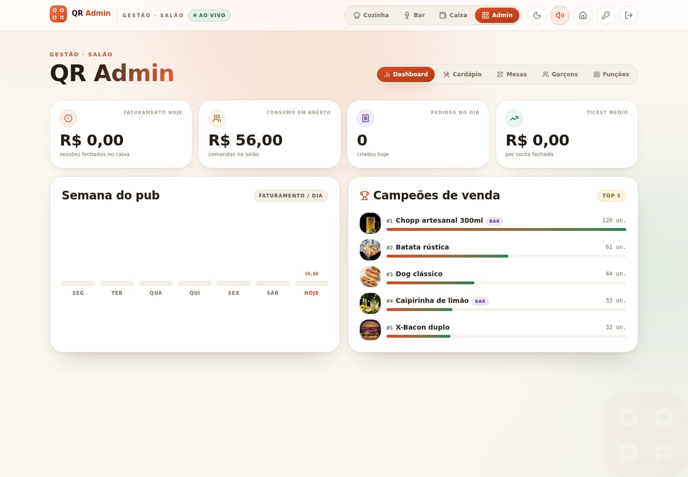
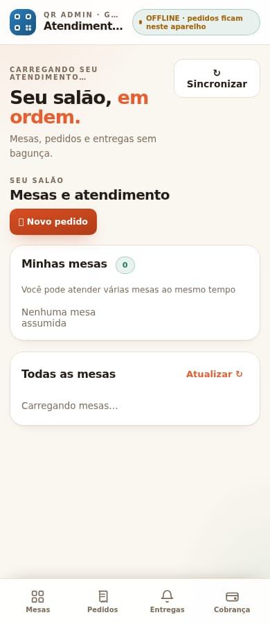
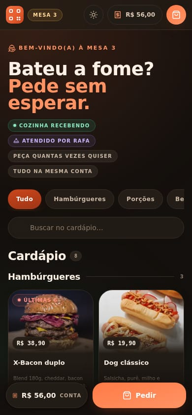

# QR Admin · Design System v2 — “Mesa & Brasa”

> Documento de entrega do redesign visual do QR Admin. Cobre a paleta, a tipografia,
> espaçamento, raios, sombras, componentes, regras de consistência, o que mudou em cada
> tela e a confirmação de que nenhuma funcionalidade foi alterada.
>
> Manual visual (abre no navegador, com alternância claro/escuro): [`docs/design-system/index.html`](./design-system/index.html)
> Fonte única de verdade dos tokens: [`src/index.css`](../src/index.css) · espelho em JS: [`src/lib/tema.ts`](../src/lib/tema.ts)

---

## 1. Direção e princípios

**Food-tech clean de lanchonete moderna:** aconchegante, limpo, confiável. Papel creme no
fundo, cartões brancos, tinta quente (nunca cinza puro), brasa como marca e manjericão como
confirmação. Alto contraste onde a equipe trabalha (cozinha, bar, caixa) e aconchego onde o
cliente pede (mesa).

| Princípio | Como aparece no produto |
| --- | --- |
| **Calor antes de frieza** | Sombras tingidas de marrom `#3a2514`; superfícies creme; zero `slate`/`zinc` puro. |
| **Contraste onde importa** | Cozinha/Bar com tipografia grande, chips de status sólidos e botões de 48–52px. |
| **Uma primária por tela** | Só o CTA que avança o fluxo é brasa; o resto é superfície/contorno. |
| **Estado é palavra + cor + ícone** | Nunca cor sozinha (daltonismo, luz forte, tela suja de farinha). |
| **Mobile-first** | Alvo mínimo de 42–44px, navegação inferior com safe-area no PWA, densidade que respira. |
| **Movimento discreto** | Entradas de 0,2–0,5s com `--ease-out-soft`; hover eleva 1–2px; `prefers-reduced-motion` respeitado. |

---

## 2. Paleta

Cada tom existe em **claro** e **escuro**. Nenhum componente usa hex direto: tudo passa por
`var(--qr-*)` (camada semântica) ou pelas classes Tailwind remapeadas em `@theme inline`.

### 2.1 Primária — Brasa

| Token | Claro | Escuro | Uso |
| --- | --- | --- | --- |
| `brand-50` | `#fff4ed` | `#3a2117` | fundo de chip/ícone |
| `brand-100` | `#ffe5d5` | `#4a2a1c` | realce suave |
| `brand-200` | `#fec9ac` | `#5e3423` | borda de destaque |
| `brand-300` | `#fba57c` | `#8a4a2c` | detalhe gráfico |
| `brand-400` | `#f47f50` | `#ff8b57` | gradientes |
| **`brand-500`** | **`#e85d2f`** | **`#ff7a45`** | marca, foco, preço |
| `brand-600` | `#d1481f` | `#ff9364` | hover / palavra-chave do título |
| `brand-700` | `#a93a1a` | `#ffb08a` | texto brasa sobre creme |
| `fill-brand` | `#d94e22 → #b03c17` | `#c9451c → #a03616` | preenchimento de botão/aba (sempre texto branco) |

### 2.2 Secundária — Manjericão

| Token | Claro | Escuro | Uso |
| --- | --- | --- | --- |
| `teal-400` | `#4cb98a` | `#4ed3a0` | gradiente de barra |
| **`teal-500`** | **`#2c9b6d`** | **`#35c08c`** | pronto, sucesso, salão livre |
| `teal-600` | `#1f8059` | `#5fe0ae` | texto de sucesso |
| `teal-700` | `#17694a` | `#8cebc5` | texto sobre fundo claro |
| `fill-success` | `#1f8059 → #17694a` | `#17694a → #12543b` | confirmação na cozinha/bar |

### 2.3 Neutros — papel e tinta

| Token | Claro | Escuro | Uso |
| --- | --- | --- | --- |
| `page` | `#faf6f0` | `#14100d` | fundo da aplicação |
| `card` / `white` | `#ffffff` | `#221c16` | superfície de cartão |
| `slate-50` | `#fbf7f2` | `#14100d` | fundo de coluna de operação |
| `slate-100` | `#f4efe7` | `#2a221c` | trilho, hover, divisor suave |
| `slate-200` (hairline) | `#e8dfd1` | `#3a2f27` | borda de 1px |
| `slate-300` | `#d7c9b7` | `#4e4034` | borda ativa |
| `slate-400` | `#a9998a` | `#8c7a68` | ícone desligado |
| `slate-500` | `#7c6b5c` | `#b6a28e` | texto secundário |
| `navy-900` (tinta) | `#241c16` | `#fcf1e4` | texto principal |

### 2.4 Semânticas

| Papel | Token | Claro | Escuro |
| --- | --- | --- | --- |
| Sucesso | `teal-500` | `#2c9b6d` | `#35c08c` |
| Erro | `rose-500` | `#e2453a` | `#ff6b5e` |
| Aviso | `amber-500` | `#f0a020` | `#f7b84b` |
| Info | `sky-500` | `#2b7fbf` | `#6cb6ea` |
| Garçom (auxiliar) | `violet-500` | `#8a5cd6` | `#a78bfa` |

Cada semântica tem par `-soft` (fundo 10–15%) + `-700` (texto) para chips legíveis nos dois temas.

### 2.5 Como usar as cores

```css
/* certo — token semântico */
.badge { background: color-mix(in srgb, var(--qr-teal-500) 12%, transparent); color: var(--qr-teal-700); }

/* errado — hex solto no componente */
.badge { background: #e6f6ee; color: #1f8059; }
```

---

## 3. Tipografia

| Papel | Família | Onde |
| --- | --- | --- |
| Display | **Bricolage Grotesque** (`--font-display`, `.font-display`) | títulos de tela, KPI, preço de destaque, hero |
| Interface | **Plus Jakarta Sans** (`--font-sans`) | corpo, rótulos, botões, tabelas |
| Numérico | **JetBrains Mono** (`--font-mono`, `.ds-number`, `.tabular`) | dinheiro, horários, contadores, IDs |

Display usa tracking `-0.02em` a `-0.035em` e sempre uma palavra em `text-brand-600`
(ex.: “Chapa **acesa**”, “Fecha a **conta**”, “zero **atrito**”).

### Escala

| Token | Tamanho | Uso |
| --- | --- | --- |
| `text-3xs` | 10 px | cabeçalho de tabela, metadado (caixa alta + `0.2em`) |
| `text-2xs` | 11 px | kicker com ícone |
| `text-xs` | 12 px | legenda e apoio |
| `text-sm` | 13 px | corpo compacto de cartão/lista |
| `text-base` | 15 px | corpo padrão |
| `text-lg` | 17 px | título de cartão |
| `text-2xl` | 24 px | título de bloco |
| `text-4xl` | 36 px | título de tela |
| `text-6xl` | 60 px | hero (landing / mesa) |

Regras: linha 1,5 no corpo e 1,05–1,15 em display; caixa alta só em rótulos ≤11 px;
nunca justificar; nunca texto abaixo de 12 px em área operacional.

---

## 4. Espaço, raio, sombra e movimento

**Espaçamento (grade de 4 px):** 4 · 8 · 12 · 16 · 24 · 32 · 48 · 64.
Cartões `p-5`/`p-6`, listas `gap-3`, seções `py-14`/`py-20`, respiro lateral `px-5` (mobile) e `px-8` (desktop).

**Raios:** `sm 8` (input/badge) · `lg 16` (botão) · `xl 18` · `2xl 22` (cartão) · `3xl 28` (bloco) · `4xl 36` (hero/faixa) · `full` (pílula, avatar, contador).

**Sombras (todas tingidas de `#3a2514`; no escuro, preto):**

| Token | Uso |
| --- | --- |
| `--shadow-soft` | repouso de cartões pequenos |
| `--shadow-card` | superfície padrão |
| `--shadow-lift` | hover, modal, painel flutuante |
| `--shadow-brand` | CTA brasa |
| `--shadow-success` | CTA de confirmação |

**Movimento:** `--ease-out-soft: cubic-bezier(.16,1,.3,1)`; `.btn-press` (`active: scale(.97)`),
`pulseSoft` (ao vivo), `shimmer` (esqueleto), `floaty` (ornamento), `marquee`, `tick`, `rise`.
Durações 160–500 ms. Tudo desligado em `prefers-reduced-motion: reduce`.

---

## 5. Arquitetura de tokens

```
src/index.css
├─ @theme              → famílias, escala, raios, sombras, keyframes (vira classe Tailwind)
├─ @theme inline       → ~35 cores legadas (slate/navy/brand/teal/amber/rose/sky/violet)
│                        remapeadas para var(--qr-*)  ← garante compatibilidade total
├─ :root               → valores do tema claro + tokens de preenchimento
├─ [data-theme=escuro] → mesmos nomes, valores escuros
└─ @layer components   → .ds-* (card, btn, input, chip, table, stat, progress, toolbar…)
```

* `src/lib/tema.ts` espelha os mesmos valores (`VARS_CLARO` / `VARS_ESCURO`) para aplicar o
  tema antes do primeiro paint (sem flash).
* O tema vive em `localStorage` (`qradmin-tema`) e no atributo `data-theme` do `<html>`.
* **Contrato mantido:** nomes de classe antigos continuam válidos. Nenhum componente precisou
  reescrever lógica; a mudança é de valor, não de API.

---

## 6. Componentes

### 6.1 Classes do sistema (`@layer components`)

| Classe | O que é |
| --- | --- |
| `.ds-card` / `.ds-card-raised` / `.ds-card-quiet` | superfícies (branca + hairline + raio 2xl; elevada; discreta) |
| `.ds-kicker` / `.ds-label` | rótulo com ícone (11 px, `0.24em`) / rótulo de formulário |
| `.ds-title` | título display com tracking negativo |
| `.ds-number` | número display tabular (dinheiro/KPI) |
| `.ds-btn` + `--brand` `--success` `--danger` `--surface` `--outline` + `--sm` `--lg` `--block` | botões |
| `.ds-input` `.ds-select` `.ds-textarea` | campos (fundo creme, foco em brasa com anel de 4 px) |
| `.ds-chip` (+ `data-active="true"`) | pílula de filtro/status |
| `.ds-table` | tabela com cabeçalho 10 px e hairline |
| `.ds-empty` | estado vazio com ícone tracejado |
| `.ds-stat` / `__label` / `__value` | cartão de métrica |
| `.ds-progress` > `span` | barra de progresso (pagamento, preparo) |
| `.ds-toolbar` (+ `data-on`) | botão de barra de ferramentas |
| `.fill-brand` / `.fill-success` | preenchimento em gradiente (pílula ativa, CTA) — garante contraste no escuro |

### 6.2 Componentes React (`src/components/ui.tsx`)

| Componente | Variantes | Nota |
| --- | --- | --- |
| `Logo` | `size sm/md/lg`, `somenteMarca` | símbolo QR (3 finders + 2 módulos) sobre gradiente brasa; wordmark some abaixo de `sm` |
| `ThemeToggle` | — | alterna claro/escuro e persiste |
| `Btn` | `brand · success · danger · surface · outline` × `sm · md · lg · block` | mapeia para `.ds-btn--*` |
| `IconButton` | — | alvo de 38–44 px, anel de foco visível |
| `Badge` | `tone` (slate/brand/teal/amber/rose/sky/violet), `pulse` | cor + palavra + ponto opcional |
| `Modal` | `wide`, `closeOnBackdrop` | folha central `max-h 84dvh`, cabeçalho/rodapé fixos, corpo rolável |
| `Qtd` | — | stepper de quantidade |
| `LivePill` | — | “ao vivo” com ponto pulsante |
| `Secao` | kicker + título | cabeçalho padrão de seção |
| `Input` | `prefix` | campo com prefixo monetário/ícone |

### 6.3 Padrões fixados

* **Header sticky:** `bg-white/85 backdrop-blur-xl` + hairline; marca à esquerda, navegação de
  posto em pílula segmentada com indicador `.fill-brand`, ações em ícone à direita.
* **Abertura de tela:** kicker (ícone Lucide + 11 px `0.26em`) → título display → subtítulo
  `slate-500`; métricas de contexto em chips à direita.
* **Cartões de operação (cozinha/bar):** borda superior de acento por estágio (`amber` fila,
  `brand` produção, `teal` pronto), contador mono, título display, itens com status em chip.
* **Dinheiro:** `.tabular` / `.ds-number`, alinhado à direita; nunca animar o dígito.
* **CTA:** `.ds-btn--brand` (uma por tela); confirmação na cozinha/bar é `.ds-btn--success`.

---

## 7. Regras de consistência

1. **Zero hex em componente.** Cor sempre por token.
2. **Superfície = `.ds-card`.** Não empilhar duas sombras fortes no mesmo nível.
3. **Uma primária por tela.**
4. **Status sempre em chip/badge** com cor + palavra (+ ícone quando muda de fluxo).
5. **Dinheiro e tempo em tabular**, alinhados à direita.
6. **Kicker + título display** abre cada área; uma palavra em brasa.
7. **Header sticky** com blur; navegação de posto em pílula.
8. **Movimento 0,2–0,5 s** com `--ease-out-soft`; hover eleva no máximo 2 px.
9. **Contraste:** texto secundário nunca abaixo de `slate-500`; sobre brasa, apenas branco.
10. **Mobile-first:** toque ≥42 px, barra inferior com `safe-area-inset`, hover nunca é a única pista.

---

## 8. O que mudou em cada tela

> Todas as capturas em [`docs/design-system/prints/`](./design-system/prints/) (claro e escuro).

### Landing
Hero com título display em três linhas (“Sentou. Escaneou. Pediu.”), palavra em brasa,
chips de contexto e *card* “Agora no salão” com métricas ao vivo. Seção “Quatro telas, zero
atrito” em 4 cartões numerados (01–04), “Tudo incluso” em 6 cartões e faixa final escura com
CTA brasa. Fundo com halos radiais suaves (brasa + manjericão).


### Login
Cartão único central, marca grande, seletor de posto em quatro cartões coloridos (cozinha
âmbar, bar violeta, caixa verde, admin brasa), campo com prefixo e toggle de tema no canto.
Erros em chip `rose`, foco em anel de brasa.

### Mesa (cardápio do cliente)
Hero apetitoso, chips de categoria (ativo em brasa), busca em pílula, cartões de produto com
foto, preço flutuante e CTA contextual (“Adicionar” / “Montar” / “Esquecer”). Painel lateral
sticky com abas *Pedido* / *Conta*, progresso de conta e resumo de pagamento. No mobile, barra
flutuante “Pedir · R$ …” acima da barra de status.


### Cozinha
Três colunas (Na fila · Em produção · Prontos) com acento de cor no topo, contador mono e
cabeçalho com dot de estágio. Cartão de pedido com mesa em display, cliente, tempo, itens com
chip de status e ações grandes: “Aceitar pedido” (brasa), “Concluir — chama o garçom”
(manjericão), “Imprimir comanda” (superfície). Rodapé com pill “AO VIVO”.


### Bar
Mesma gramática da cozinha com acento violeta (bebidas) e hierarquia idêntica de ações, para
que a equipe troque de posto sem reaprender.


### Caixa
Lista de comandas no salão (cartão selecionado com anel brasa) + detalhe da sessão com
consumo, desconto, taxa e total. Coluna de recebimento com “Dividir a conta”, valor por
pessoa, PIX/dinheiro/crédito/débito e histórico de pagamentos em cartões de sucesso.



### Admin
Quatro cartões de KPI (faturamento, consumo em aberto, pedidos do dia, ticket médio), gráfico
“Semana do pub” com trilho visível mesmo sem dados e “Campeões de venda” com medalhas e
barras. Abas internas em pílula (Dashboard · Cardápio · Mesas · Garçons · Funções), tabelas
com cabeçalho 10 px, modais de edição com foco em brasa.


### PWA do garçom (`public/garcom-pwa/`)
Tokens do DS espelhados no CSS próprio do PWA: fundo creme com halos, header sticky compacto,
painéis com raio 22, folha de pedido centralizada (`width min(100vw-28px, 540px)`,
`max-height min(84dvh, 700px)`), barra inferior de 4 abas (Mesas · Pedidos · Entregas ·
Cobrança) com `safe-area`. Tema escuro também por `prefers-color-scheme` quando o sistema está
escuro. Cache do service worker elevado para `garcom-pwa-shell-v19`.



---

## 9. Tema claro e escuro

* Alternância por `data-theme="escuro"` no `<html>`, persistida em `localStorage`.
* `tema.ts` aplica as variáveis antes do primeiro paint (sem flash branco).
* `color-scheme: light dark` + `theme-color` por esquema no `index.html` e no PWA.
* No escuro: fundo `#14100d`, cartão `#221c16`, texto `#f7eee3`, marca mais luminosa
  (`#ff7a45`), preenchimentos de botão mais escuros (`#c9451c → #a03616`) para manter
  contraste de texto branco.
* PWA sem seletor próprio: segue `prefers-color-scheme` (com `@media` equivalente ao bloco
  `[data-theme]`).

---

## 10. Acessibilidade

* Contraste mínimo 4,5:1 em texto e 3:1 em elementos gráficos; preenchimentos brasa usam
  `#d94e22 → #b03c17` (claro) e `#c9451c → #a03616` (escuro) para garantir branco legível.
* Alvos de toque de 42 px (48–52 px na operação).
* Foco visível em todos os controles (`outline` de brasa + anel de 4 px).
* Status nunca dependem só de cor (cor + palavra + ícone).
* `prefers-reduced-motion` desliga animações de entrada e pulsos.
* `aria-label`/`role` preservados em todos os componentes originais.

---

## 11. Confirmação: nenhuma funcionalidade foi alterada

O trabalho ficou **exclusivamente na camada visual**. Não houve mudança em:

| Camada | Situação |
| --- | --- |
| Rotas / navegação por hash | intocadas |
| Endpoints da API e contratos JSON | intocados |
| Stores Zustand (`usePub` e demais) | intocados (`hydrate*`, seletores, actions) |
| Regras de negócio (pedidos, sessões, pagamentos, estoque, PIX) | intocadas |
| Fluxos do PWA (fila offline, sync, impressão, notificações, cobrança) | intocados |
| Permissões / autenticação / troca de senha | intactas |
| Estrutura de dados e migrations do backend | intocadas |

O que mudou: **classes, tokens, tipografia, cores, espaçamento, raios, sombras, ícones
decorativos e animações**. Todas as props e assinaturas dos componentes de UI foram mantidas
(`Btn`, `Badge`, `Modal`, `Input`, `Logo`…), então as telas continuam chamando as mesmas APIs
internas. O contrato de classes Tailwind legadas também foi preservado via `@theme inline`,
o que permitiu restilizar sem reescrever a lógica de nenhuma tela.

**Validações executadas:** `npx tsc --noEmit` (0 erros), `npm run build` (Vite, 0 erros) e
inspeção visual em Chromium headless — desktop 1440×900 e mobile 390×844, tema claro e escuro —
em Landing, Login, Mesa, Cozinha, Bar, Caixa, Admin e PWA do garçom.

---

## 12. Como visualizar

```bash
# manual do design system (abre direto no navegador)
open docs/design-system/index.html

# aplicação
npm run build
npm run preview -- --host 0.0.0.0 --port 4173   # http://localhost:4173
```

> `npm run dev` não é usado para validação visual neste ambiente porque o servidor Vite de
> desenvolvimento depende dos módulos do backend (`db/`); o preview do build é o caminho fiel.

---

## 13. Manutenção

* Novo tom? Adicione em `@theme inline` + `:root` + bloco escuro + `VARS_*` de `tema.ts`.
* Novo componente? Use `.ds-*` como base; só crie classe nova se o padrão se repetir 3×.
* Nova tela? Kicker + título display + `.ds-card` + uma ação `.ds-btn--brand`.
* Antes de entregar: `tsc --noEmit`, `npm run build` e revisão nas duas larguras/temas.
